# Maxim · AI Systems Engineer

**I find where engineering workflows break down and build the tools to fix them.** My focus is coding agents. I trace a task from the first command to the passing check, looking for wasted work, missing context and failures a green status can hide.

[✨ Projects](#projects) · [Field notes](#field-notes) · [Open-source tool guides](#find-a-tool-for-the-job) · [Get in touch](#get-in-touch)

<!-- BEGIN PROJECT GALLERY -->
<a id="projects"></a>

## ✨ 20 projects to explore

A selection of my own public repositories, combining the most starred projects with specialist guides. Pick a cover to open its repository.

[🧠 Agent infrastructure](#agent-infrastructure) · [🧭 Discover AI tools](#discover-ai-tools) · [📚 Skills, prompts & engineering](#skills-prompts-and-engineering) · [🎨 Creative work & practical applications](#creative-work-and-applications) · [🛠️ Desktop & coding sessions](#desktop-and-coding-sessions)

<a id="agent-infrastructure"></a>

### 🧠 Agent infrastructure

<p>
  <a href="https://github.com/Supersynergy/agent-token-saver">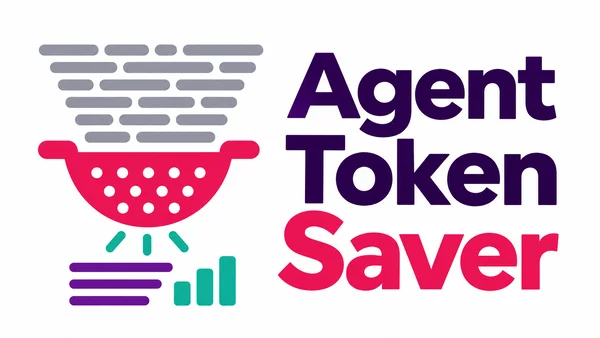</a>
  <a href="https://github.com/Supersynergy/agent-token-saver-skill-router">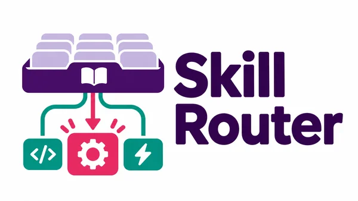</a>
  <a href="https://github.com/Supersynergy/synapse-memory">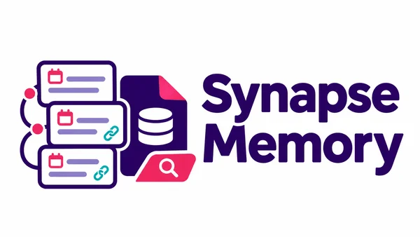</a>
  <a href="https://github.com/Supersynergy/superiss">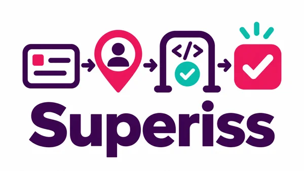</a>
</p>

- **[Agent Token Saver](https://github.com/Supersynergy/agent-token-saver)** · Run checks once and keep the evidence.
- **[Skill Router](https://github.com/Supersynergy/agent-token-saver-skill-router)** · Load the few skills a task needs.
- **[Synapse Memory](https://github.com/Supersynergy/synapse-memory)** · Search earlier decisions and their sources locally.
- **[Superiss](https://github.com/Supersynergy/superiss)** · Coordinate task ownership and require proof before done.

[↑ Back to projects](#projects)

<a id="discover-ai-tools"></a>

### 🧭 Discover AI tools

<p>
  <a href="https://github.com/Supersynergy/awesome-awesome-best-of-repo-lists">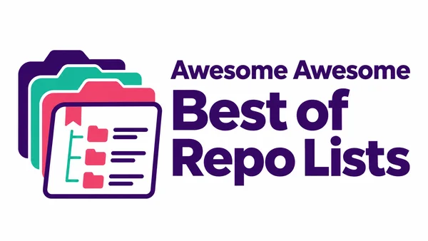</a>
  <a href="https://github.com/Supersynergy/awesome-ai-agents-2026">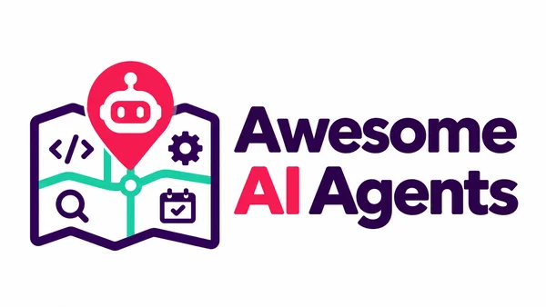</a>
  <a href="https://github.com/Supersynergy/awesome-local-ai-agents">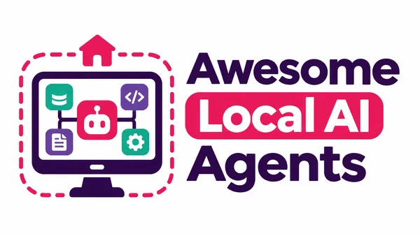</a>
  <a href="https://github.com/Supersynergy/awesome-agentic-coding">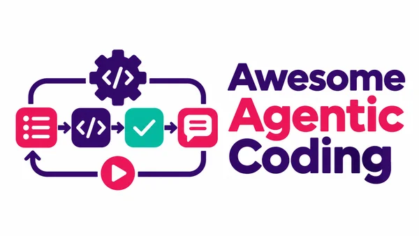</a>
</p>

- **[Awesome Awesome Best of Repo Lists](https://github.com/Supersynergy/awesome-awesome-best-of-repo-lists)** · Start here to explore collections across fields.
- **[AI Agents](https://github.com/Supersynergy/awesome-ai-agents-2026)** · Compare agents for coding, research and automation.
- **[Local AI Agents](https://github.com/Supersynergy/awesome-local-ai-agents)** · Choose models and runners for your own hardware.
- **[Agentic Coding](https://github.com/Supersynergy/awesome-agentic-coding)** · Build repeatable coding workflows with hooks and checks.

[↑ Back to projects](#projects)

<a id="skills-prompts-and-engineering"></a>

### 📚 Skills, prompts & engineering

<p>
  <a href="https://github.com/Supersynergy/awesome-skills">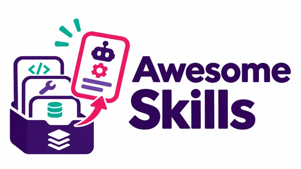</a>
  <a href="https://github.com/Supersynergy/awesome-prompts">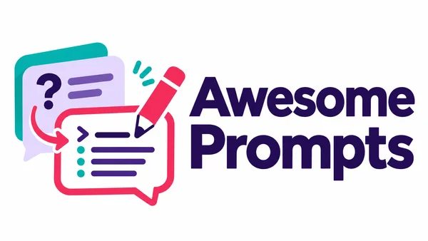</a>
  <a href="https://github.com/Supersynergy/awesome-software-gamechanger-stack">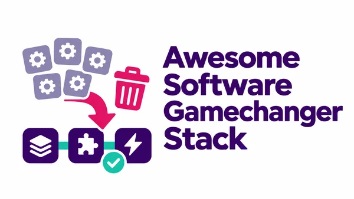</a>
  <a href="https://github.com/Supersynergy/awesome-codedesign">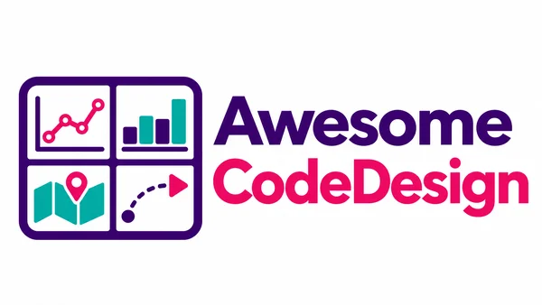</a>
</p>

- **[Awesome Skills](https://github.com/Supersynergy/awesome-skills)** · Find reusable agent skills and collections.
- **[Awesome Prompts](https://github.com/Supersynergy/awesome-prompts)** · Explore prompt libraries, guides and cookbooks.
- **[Software Gamechanger Stack](https://github.com/Supersynergy/awesome-software-gamechanger-stack)** · Compare alternatives for bottlenecks in your stack.
- **[CodeDesign](https://github.com/Supersynergy/awesome-codedesign)** · Choose tools for charts, maps, diagrams and visual work.

[↑ Back to projects](#projects)

<a id="creative-work-and-applications"></a>

### 🎨 Creative work & practical applications

<p>
  <a href="https://github.com/Supersynergy/awesome-ai-video-editing">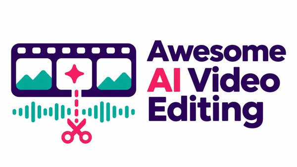</a>
  <a href="https://github.com/Supersynergy/awesome-ai-lead-generation">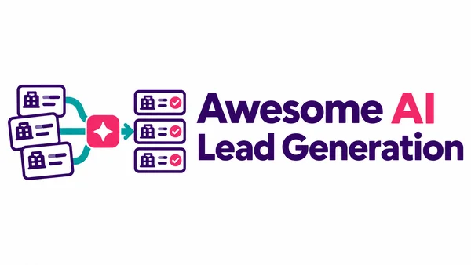</a>
  <a href="https://github.com/Supersynergy/mdviewy">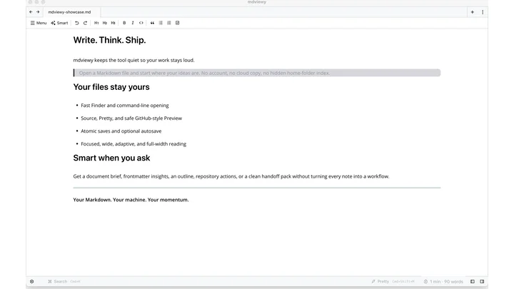</a>
  <a href="https://github.com/Supersynergy/aya-neco">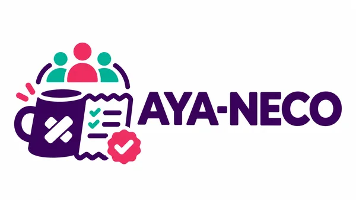</a>
</p>

- **[AI Video Editing](https://github.com/Supersynergy/awesome-ai-video-editing)** · Find editing tools and programmable media workflows.
- **[AI Lead Generation](https://github.com/Supersynergy/awesome-ai-lead-generation)** · Explore prospecting, enrichment and CRM workflows.
- **[mdviewy](https://github.com/Supersynergy/mdviewy)** · Read and edit Markdown files in an offline workspace.
- **[Aya Neco](https://github.com/Supersynergy/aya-neco)** · A research prototype for checkable community contributions.

[↑ Back to projects](#projects)

<a id="desktop-and-coding-sessions"></a>

### 🛠️ Desktop & coding sessions

<p>
  <a href="https://github.com/Supersynergy/HeavenKey">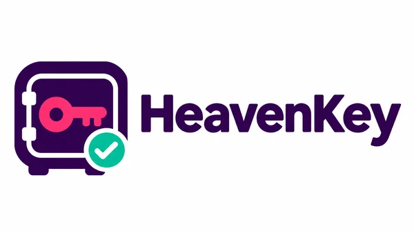</a>
  <a href="https://github.com/Supersynergy/ghostty-session-manager">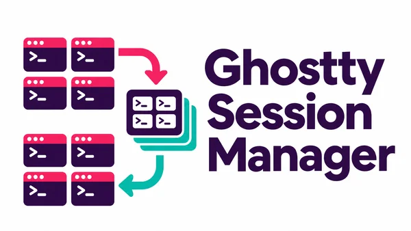</a>
  <a href="https://github.com/Supersynergy/claude-session-restore">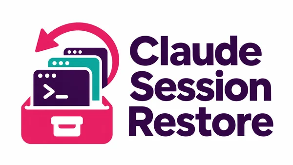</a>
  <a href="https://github.com/Supersynergy/agentmaster">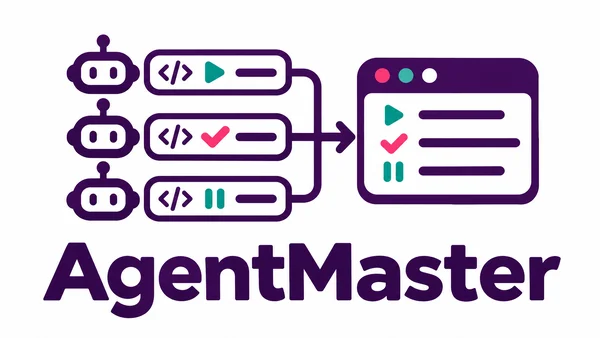</a>
</p>

- **[HeavenKey](https://github.com/Supersynergy/HeavenKey)** · A local password manager and passkeys development preview.
- **[Ghostty Session Manager](https://github.com/Supersynergy/ghostty-session-manager)** · Save terminal tabs and restore Claude conversations.
- **[Claude Session Restore](https://github.com/Supersynergy/claude-session-restore)** · Restore coding sessions across terminal applications.
- **[Agentmaster](https://github.com/Supersynergy/agentmaster)** · Watch and steer several coding assistants in one terminal.

[↑ Back to projects](#projects)

[Browse all public repositories →](https://github.com/Supersynergy?tab=repositories&type=source)
<!-- END PROJECT GALLERY -->

## Field notes

**002 · [When less context costs more](https://github.com/Supersynergy/Supersynergy/blob/main/field-notes/002-when-less-context-costs-more.md)**

One Codex setup, three tasks. A large Git diff used **42% fewer tokens**. A process table used **32% more**. The command trace shows where I’d look next.

**001 · [Why a large PDF could disappear from an Unsloth Studio chat](https://github.com/Supersynergy/Supersynergy/blob/main/field-notes/001-unsloth-attachments.md)**

The chat returned a complete answer even when the model never saw the attachment. I traced the missing passages to the retrieval fallback. [Merged fix](https://github.com/unslothai/unsloth/pull/9630)

I also contribute to **Moli**, a Rust browser used for automation. My merged fixes include a debugger reconnect race and missing events across redirects. [Reconnect fix](https://github.com/lexmount/moli/pull/2661) · [Redirect handling](https://github.com/lexmount/moli/pull/2663)

## Find a tool for the job

**Start with [Awesome Awesome Best of Repo Lists](https://github.com/Supersynergy/awesome-awesome-best-of-repo-lists)** if you’re exploring a field. It indexes 967 entries in 15 categories and has editions in 18 languages. For a specific decision, pick one of my specialist guides below.

| What are you trying to do? | Where I’d start |
| --- | --- |
| Choose an agent for code review or research, then see what you could run on your own hardware | [AI Agents](https://github.com/Supersynergy/awesome-ai-agents-2026) for the task. [Local AI Agents](https://github.com/Supersynergy/awesome-local-ai-agents) for runners, memory requirements and quantization. |
| Give a coding assistant a repeatable workflow | [Agentic Coding](https://github.com/Supersynergy/awesome-agentic-coding) for hooks and tests. [Awesome Skills](https://github.com/Supersynergy/awesome-skills) for reusable skills and their format. [Awesome Prompts](https://github.com/Supersynergy/awesome-prompts) for cookbooks and ways to evaluate a prompt. |
| Decide what to change in a slow service | [Software Gamechanger Stack](https://github.com/Supersynergy/awesome-software-gamechanger-stack) to compare parsers or queues. [Database Tools](https://github.com/Supersynergy/awesome-database-tools) to investigate slow queries or plan a migration. [Server Stack](https://github.com/Supersynergy/awesome-server-stack) for edge caching and deployment. |
| Turn a dataset into a dashboard, or show the result in a video | [CodeDesign](https://github.com/Supersynergy/awesome-codedesign) for charts, maps and diagrams. [AI Video Editing](https://github.com/Supersynergy/awesome-ai-video-editing) for editing, audio cleanup and programmable video pipelines. |
| Build a prospecting workflow for a sales team | [AI Lead Generation](https://github.com/Supersynergy/awesome-ai-lead-generation) covers discovery, enrichment, verification, scoring and CRM integration. |

<details>
<summary>Browse all 15 catalog categories or query the data yourself</summary>

- Building software · Languages and ecosystems, AI and agents, data and APIs, starter projects.
- Running software · DevOps and cloud, self-hosting and homelabs, security and privacy, supply chain and licenses.
- Applying software · Business and SaaS, research and papers, public sector.
- Finding other collections · Meta-lists, best-of rankings, registries, official catalogs.

For example, to make a reading list for a self-hosted deployment, run this from a checkout of the catalog:

```sh
jq -r 'select(.cat == "selfhosted") | .url' data/sources.jsonl
```

[Browse by category](https://github.com/Supersynergy/awesome-awesome-best-of-repo-lists#contents) · [Catalog fields and examples](https://github.com/Supersynergy/awesome-awesome-best-of-repo-lists/blob/main/CATALOG.md)

</details>

## Local-first agent infrastructure

**Synapse Memory** gives a fresh coding session a brief drawn from earlier decisions and bug fixes. The Rust CLI keeps dated notes and their sources in one SQLite file. [Try it with your first note](https://github.com/Supersynergy/synapse-memory#first-steps)

**Superiss** coordinates agents working on the same project. A worker claims a task, runs its acceptance check and attaches the passing result before closing it. The runnable example also shows what happens when a worker tries to close without proof. [Run the example](https://github.com/Supersynergy/superiss#try-the-complete-loop)

## Get in touch

For engineering roles or collaborations in developer productivity, AI systems or workflow optimization, [start a conversation on my profile repository](https://github.com/Supersynergy/Supersynergy/issues/new). This is public, so a role link and a way for me to reply are enough.
