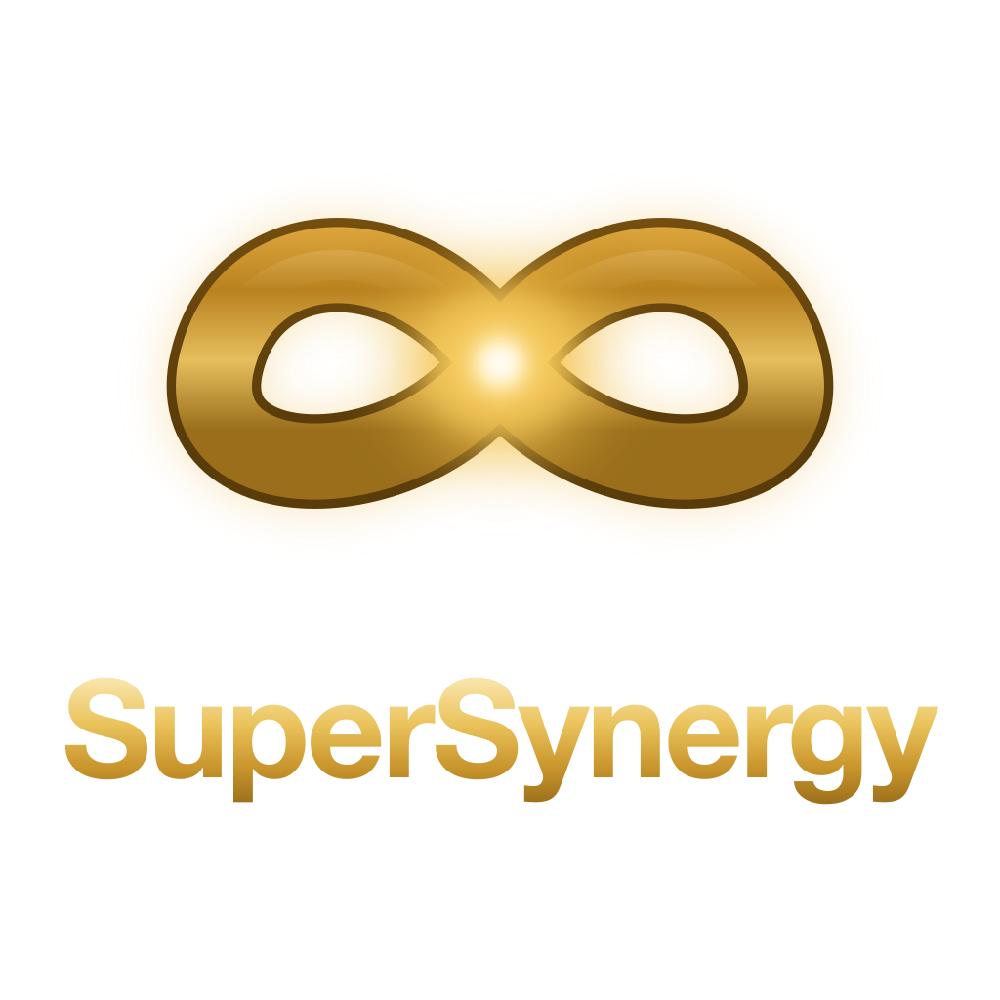

# Maxim · AI Systems & Developer Tools Engineer

I build local-first tools in Rust, Python and TypeScript. My work on coding agents started with three questions. What did this task cost? What should the next session remember? How can another engineer check that the work is done?

I also maintain **Awesome Awesome Best of Repo Lists**, a catalog of **967 entries across 15 categories**, with reading guides in **18 languages**. Browse the lists by subject or query the JSONL dataset for a shortlist of your own. [Explore the catalog](https://github.com/Supersynergy/awesome-awesome-best-of-repo-lists) · [Query the data](https://github.com/Supersynergy/awesome-awesome-best-of-repo-lists/blob/main/CATALOG.md)

## Supersynergy Field Notes

[001 · Why a large PDF could disappear from an Unsloth Studio chat](https://github.com/Supersynergy/Supersynergy/blob/main/field-notes/001-unsloth-attachments.md) — Two nearly identical requests meant different things. A 50,000-token test file shows where passage retrieval went missing.

## Selected work

- Kept large attachments usable in Unsloth Studio. When an attachment exceeded the model’s context budget, Auto mode could silently drop the entire document. My merged fix retrieves relevant passages and preserves the user’s explicit Off setting. [Unsloth PR #9630](https://github.com/unslothai/unsloth/pull/9630)
- Measured the token cost of a leaner Codex workflow. I built Agent Token Saver to trim repeated context and noisy tool output. Across three tasks, the provider reported 90,364 tokens with the tool versus 112,488 at baseline (**19.67% fewer**). All three task checks passed. Each arm ran once, and one task used more tokens. [Benchmark and per-task results](https://github.com/Supersynergy/agent-token-saver#benchmarks)
- Improved browser automation in Moli. Seven of my changes landed in this Rust browser. They include keeping the page loading after a startup script throws, fixing a debugger reconnect race, and reporting requests across redirects. [Script recovery](https://github.com/lexmount/moli/pull/1177) · [Reconnect fix](https://github.com/lexmount/moli/pull/2661) · [Redirect handling](https://github.com/lexmount/moli/pull/2663)

## Local-first agent infrastructure

**Synapse Memory** gives a fresh coding session a brief drawn from earlier decisions and bug fixes. The Rust CLI keeps dated notes and their sources in one SQLite file. [Try it with your first note](https://github.com/Supersynergy/synapse-memory#first-steps)

**Superiss** coordinates agents working on the same project. A worker claims a task, runs its acceptance check and attaches the passing result before closing it. The runnable example also shows what happens when a worker tries to close without proof. [Run the example](https://github.com/Supersynergy/superiss#try-the-complete-loop)

## More projects to try

| When you want to… | Start here |
| --- | --- |
| Check what is out of date across Homebrew, Cargo, npm and nine other package managers | [PUM](https://github.com/Supersynergy/pum) |
| See what Claude Code, Codex and Gemini CLI sessions are doing from your Mac menu bar | [AGIMON](https://github.com/Supersynergy/agimon) |
| Give a coding agent only the skills its current task needs | [Agent Token Saver Skill Router](https://github.com/Supersynergy/agent-token-saver-skill-router) |
| Scroll a teleprompter at your speaking pace using on-device speech recognition | [Teleprompter](https://github.com/Supersynergy/teleprompter) |

## Field guides

I keep focused guides alongside the main catalog. For a coding or research workflow, start with [Awesome AI Agents](https://github.com/Supersynergy/awesome-ai-agents-2026), then browse [Awesome Skills](https://github.com/Supersynergy/awesome-skills) for a reusable capability. For a video workflow, [Awesome AI Video Editing](https://github.com/Supersynergy/awesome-ai-video-editing) covers editing tools, audio finishing and CLI pipelines an agent can run.

## Get in touch

For engineering roles or collaborations in AI infrastructure, developer tooling or local-first software, [start a conversation on my profile repository](https://github.com/Supersynergy/Supersynergy/issues/new). This is public, so a role link and a way for me to reply are enough.
